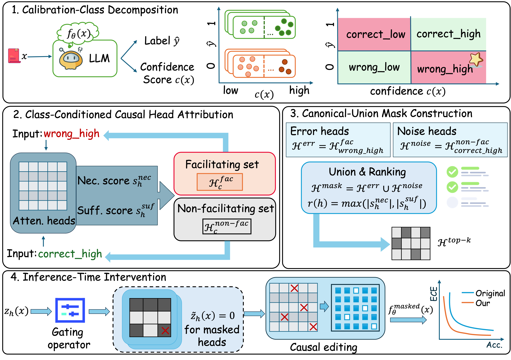

<h1 align="center"><b>Correcting Overconfident Errors via Causal Head Intervention</b></h1>

<p align="center">
  
</p>

---

- Paper: **Why Are LLMs Confidently Wrong? Correcting Overconfident Errors via Causal Head Intervention**
- Authors: [Jing Ren](https://scholar.google.com/citations?hl=en&authuser=1&user=fUjL_jYAAAAJ), [Bowen Li](https://scholar.google.com/citations?user=D3-py-8AAAAJ&hl=en&authuser=1), [Ziqi Xu](https://scholar.google.com/citations?user=znODztEAAAAJ&hl=en&oi=ao), [Xuechao Yang](https://scholar.google.com/citations?user=1iN2cx0AAAAJ&hl=en), [Feng Xia](https://scholar.google.com/citations?hl=en&authuser=1&user=HDFA2VYAAAAJ)
- Venue: **NeurIPS 2026**
- Keywords: Large Language Models, Overconfidence, Causal Intervention, Circuit Analysis
- Licenses: MIT (code)

## TL;DR

This repository provides the official implementation for the NeurIPS 2026 paper "Why Are LLMs Confidently Wrong?", introducing a causal head intervention framework to diagnose and correct overconfident errors in Large Language Models.

## Quickstart

```bash
make help

# 1. Prepare Dataset
make prepare DATASET=mmlu_all_test

# 2. Run Experiments
make experiment     DATASET=mmlu_all_test MODEL=llama3.1-8b SEED=0

make main           DATASET=mmlu_all_test MODEL=gemma2-9b
make ablation       DATASET=mmlu_all_test MODEL=gemma2-9b
make hyperparameter DATASET=mmlu_all_test MODEL=gemma2-9b
make case-study     DATASET=mmlu_all_test MODEL=gemma2-9b

# Run all with seed 0
make all SEED=0
```

## Acknowledgment
> We express our gratitude to the RMIT RACE (RMIT Advanced Compute Environment) facility for providing the high-performance computational resources and infrastructure that enabled this research. 

- Special thanks to [Patrick Taylor](https://www.linkedin.com/in/patrick-d-taylor) for his invaluable support and assistance.
- Special thanks to [Jack Li](https://github.com/Comanx) for contributing to GitHub Pages development.

<p align="center">
  
</p>


## LICENSE

[MIT](./LICENSE) License for code; paper content under CC BY 4.0.
